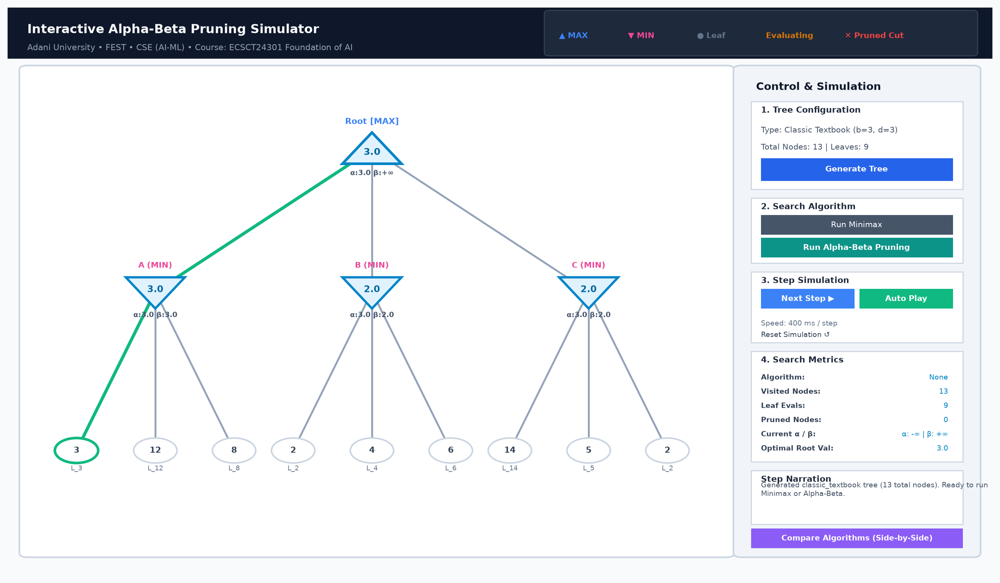
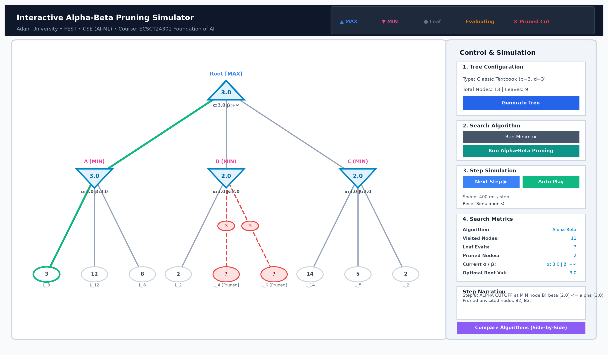
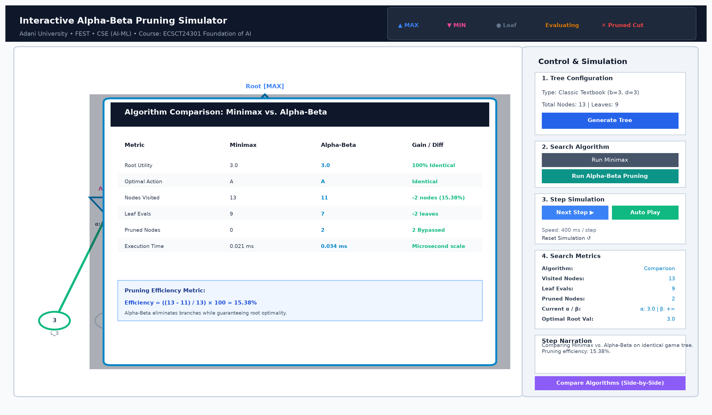

# Interactive Alpha-Beta Pruning Simulator for Adversarial Game-Tree Search

[](https://www.python.org/downloads/)
[](LICENSE)
[]()
[]()

> **Project-Based Learning (PBL) Submission**  
> **Course:** ECSCT24301 – Foundation of AI  
> **University:** Adani University  
> **Faculty:** Faculty of Engineering Sciences and Technology (FEST)  
> **Department:** Department of Computer Science and Engineering (AI-ML)  
> **Academic Year:** 2026–27  
> **Track:** Applied AI Project Track  

---

## 1. Project Overview

In two-player, turn-based, zero-sum games with perfect information (such as Chess, Checkers, Connect Four, or Tic-Tac-Toe), decision-making relies on exploring future game states to identify optimal moves. The classical **Minimax algorithm** accomplishes this by exhaustively exploring all reachable terminal states, assuming rational adversarial play. However, Minimax incurs an exponential time complexity of $\mathcal{O}(b^d)$, where $b$ is the branching factor and $d$ is the search depth.

**Alpha-Beta Pruning** is a foundational branch-and-bound optimization that computes the exact same optimal minimax decision while eliminating subtrees that are mathematically guaranteed not to influence the final choice. 

This repository provides a complete, beginner-friendly **Interactive Graphical Simulator** built from scratch in Python and Tkinter. The simulator visualizes the internal mechanics of adversarial search, animates dynamic $\alpha$ and $\beta$ bound updates, marks branch cutoffs, and provides rigorous empirical benchmarks and automated academic documentation.

---

## 2. Key Features

- **Scratch Implementations:** Pure Python, zero-abstraction implementations of Minimax and Alpha-Beta Pruning with clear docstrings suitable for viva defense.
- **Dynamic Tree Generation:**
  - *Classic Textbook Tree:* Canonical 3-ply Russell & Norvig example demonstrating clear $\alpha$-$\beta$ cutoffs.
  - *Binary 4-Ply Tree:* Full binary tree with multi-level cutoffs.
  - *Custom Parameterized Trees:* Configurable branching factor ($b \in [2, 4]$), depth ($d \in [2, 5]$), and deterministic random seeds.
- **Interactive Tkinter Canvas Visualizer:**
  - Distinct polygonal geometry: **▲ Blue Upward Triangles** for MAX nodes, **▼ Pink Downward Triangles** for MIN nodes, and **● Circles** for leaf utilities.
  - Visual status color codes: White (Unevaluated), Amber (Active Evaluation), Light Blue (Evaluated), and Light Red (Pruned).
  - Explicit cut markers: Red scissor crosses (**✕**) marking cut branches.
  - Optimal decision path: Highlighted in emerald green lines from root to leaf.
- **Decoupled Event-Driven Replay:**
  - Search algorithms generate a chronological execution trace (`SearchEvent`).
  - Interactive playback controls: **Next Step ▶**, **Auto Play**, **Pause ⏸**, **Reset ↺**, and a real-time **Speed Slider** (100 ms to 1200 ms per step).
  - Educational step narration explaining every visit, leaf evaluation, bound update, and branch cutoff.
- **Side-by-Side Comparison Modal:**
  - Compares Minimax and Alpha-Beta on identical trees.
  - Formulates and displays the exact pruning efficiency metric:
    $$\text{Pruning Efficiency (\%)} = \left(\frac{\text{Minimax Visited} - \text{Alpha-Beta Visited}}{\text{Minimax Visited}}\right) \times 100$$
- **Rigorous Benchmarking & Empirical Ablation:**
  - Multi-trial benchmarking across 12 problem configurations with median execution timings.
  - Move-ordering ablation study (Best-Case, Random, and Worst-Case ordering).
  - Generates publication-ready 300 DPI Matplotlib charts.
- **Automated Word Documentation:**
  - Python script (`scripts/generate_report.py`) dynamically generates a complete 25+ page academic report (`documentation/project_report.docx`) conforming strictly to the Adani University PBL report format.

---

## 3. Technology Stack

- **Core Language:** Python 3 (Tested on Python 3.10 – 3.14)
- **Graphical User Interface (GUI):** Tkinter (Python standard library)
- **Vector Visualization:** Tkinter Canvas
- **Empirical Benchmarking:** Python `time.perf_counter`, `csv`, and `statistics` (Python standard library)
- **Data Visualization & Charts:** Matplotlib (`matplotlib>=3.8.0`)
- **Report Generation:** `python-docx>=1.1.0`
- **Unit Testing:** Python `unittest` framework

Dependencies are kept minimal to ensure straightforward installation without version conflicts.

---

## 4. Project Architecture

```text
Alpha-Beta-Pruning/
│
├── main.py                          # Primary CLI / GUI application entry point
├── requirements.txt                 # Project dependencies (matplotlib, python-docx, pillow)
├── README.md                        # Comprehensive documentation and guide
├── .gitignore                       # Git ignore configuration
│
├── core/                            # Core game-tree representation and generation
│   ├── __init__.py                  # Package exports
│   ├── game_tree.py                 # Node data structure and tree topology
│   └── tree_generator.py            # Predefined, random trees, and 2D canvas layout
│
├── algorithms/                      # Adversarial search algorithms
│   ├── __init__.py                  # Package exports
│   ├── trace.py                     # SearchEvent and SearchResult dataclasses
│   ├── minimax.py                   # Classical Minimax implementation with tracing
│   └── alpha_beta.py                # Alpha-Beta Pruning implementation with tracing
│
├── gui/                             # Graphical User Interface (Tkinter)
│   ├── __init__.py                  # Package exports
│   ├── tree_visualizer.py           # Tkinter Canvas renderer with node shapes & cutoffs
│   ├── controls.py                  # Simulation buttons, speed slider, and metrics panel
│   └── main_window.py               # Main application window & comparison modal
│
├── benchmarks/                      # Empirical performance benchmarking
│   ├── __init__.py                  # Package exports
│   ├── benchmark.py                 # Multi-trial scaling experiments and ordering ablation
│   ├── results.csv                  # Scaling benchmark data
│   ├── ordering_results.csv         # Move-ordering ablation benchmark data
│   └── generate_charts.py           # Publication-grade chart generation script
│
├── tests/                           # Verification unit tests
│   ├── __init__.py                  # Package exports
│   ├── test_minimax.py              # Unit tests for Minimax correctness
│   └── test_alpha_beta.py           # Unit tests for Alpha-Beta optimality & pruning
│
├── documentation/                   # Academic documentation and figures
│   ├── project_report.docx          # Complete generated Word report
│   ├── charts/                      # 300 DPI comparative benchmark charts
│   │   ├── tree_size_vs_nodes_visited.png
│   │   ├── tree_depth_vs_runtime.png
│   │   ├── minimax_vs_alphabeta_evaluations.png
│   │   └── ordering_effect_on_pruning.png
│   └── screenshots/                 # High-resolution GUI demonstration captures
│       ├── gui_initial_state.png
│       ├── gui_step_by_step_execution.png
│       ├── gui_alpha_beta_pruning_complete.png
│       └── gui_algorithm_comparison_modal.png
│
└── scripts/                         # Automation scripts
    ├── generate_report.py           # Automated python-docx report compiler
    └── capture_screenshots.py       # Screenshot generation utility
```

---

## 5. Installation Instructions

### Prerequisites
- Python 3.10 or higher installed on your system.
- Standard Tkinter support (included by default in standard Python installers for Windows and macOS).

### Step-by-Step Setup

1. **Clone the repository:**
   ```bash
   git clone https://github.com/lokeshlohar2006/Alpha-Beta-Pruning.git
   cd Alpha-Beta-Pruning
   ```

2. **Create and activate a virtual environment (optional but recommended):**
   ```bash
   python -m venv venv
   # Windows:
   venv\Scripts\activate
   # macOS / Linux:
   source venv/bin/activate
   ```

3. **Install dependencies:**
   ```bash
   pip install -r requirements.txt
   ```

---

## 6. How to Run the Application

### 1. Launch the Interactive GUI (Default Mode)
```bash
python main.py
```
This opens the simulator window where you can:
- Select a tree variant (**Classic Textbook**, **Binary 4-Ply**, or **Custom Random**).
- Configure branching factor $b$ and search depth $d$.
- Click **Run Minimax** or **Run Alpha-Beta Pruning**.
- Use **Next Step ▶** to step through traversal or **Auto Play** for animated execution.
- Click **Compare Algorithms** for a side-by-side efficiency dialog.

### 2. Command-Line Demo (Quick Terminal Output)
```bash
python main.py --cli
```

### 3. Run the Unit Test Suite
```bash
python main.py --test
# Or directly via unittest:
python -m unittest discover tests/
```

### 4. Run the Empirical Benchmark Suite
```bash
python main.py --benchmark
```

### 5. Generate Comparative Charts
```bash
python main.py --charts
```

### 6. Re-generate the Academic Word Report
```bash
python scripts/generate_report.py
```

---

## 7. Sample Output and Benchmark Results

### Terminal CLI Comparison Sample

```text
======================================================================
ALPHA-BETA PRUNING SIMULATOR (CLI DEMO)
Course: ECSCT24301 Foundation of AI | Adani University
======================================================================

--- RESULTS ON CLASSIC TEXTBOOK TREE ---
Metric                       | Minimax         | Alpha-Beta     
-----------------------------------------------------------------
Optimal Root Value           | 3.0             | 3.0            
Best Action Choice           | A               | A              
Nodes Visited                | 13              | 11             
Leaf Evaluations             | 9               | 7              
Pruned Nodes                 | 0               | 2              
Execution Time (ms)          | 0.0216          | 0.0349         
-----------------------------------------------------------------
Calculated Pruning Efficiency: 15.38%
```

### Measured Benchmark Summary Table

The table below summarizes measured empirical data from `benchmarks/results.csv`:

| Config $(b, d)$ | Total Nodes | Root Val | Minimax Visited | Alpha-Beta Visited | Pruned Nodes | Pruning Efficiency (%) |
| :---: | :---: | :---: | :---: | :---: | :---: | :---: |
| $b=2, d=2$ | 7 | 4.0 | 7 | 7 | 0 | 0.00% |
| $b=2, d=3$ | 15 | 32.0 | 15 | 14 | 1 | 6.67% |
| $b=2, d=4$ | 31 | 18.0 | 31 | 27 | 4 | 12.90% |
| $b=2, d=5$ | 63 | 16.0 | 63 | 55 | 8 | 12.70% |
| $b=2, d=6$ | 127 | 18.0 | 127 | 73 | 54 | 42.52% |
| $b=3, d=2$ | 13 | 42.0 | 13 | 13 | 0 | 0.00% |
| $b=3, d=3$ | 40 | 12.0 | 40 | 27 | 13 | 32.50% |
| $b=3, d=4$ | 121 | 29.0 | 121 | 53 | 68 | **56.20%** |
| $b=3, d=5$ | 364 | 22.0 | 364 | 144 | 220 | **60.44%** |
| $b=4, d=2$ | 21 | 37.0 | 21 | 21 | 0 | 0.00% |
| $b=4, d=3$ | 85 | 17.0 | 85 | 49 | 36 | 42.35% |
| $b=4, d=4$ | 341 | 18.0 | 341 | 189 | 152 | 44.57% |

*Key Takeaway:* In all 12 test instances, Minimax and Alpha-Beta returned **100% identical root utility values**, demonstrating that Alpha-Beta Pruning achieves substantial search reductions (up to 60.44%) without sacrificing decision quality.

---

## 8. Theoretical Complexity Analysis

Let $b$ represent the uniform branching factor (legal actions per non-terminal node) and $d$ represent the search depth (ply):

| Algorithm | Best-Case Time | Average-Case Time | Worst-Case Time | Space Complexity |
| :--- | :---: | :---: | :---: | :---: |
| **Standard Minimax** | $\mathcal{O}(b^d)$ | $\mathcal{O}(b^d)$ | $\mathcal{O}(b^d)$ | $\mathcal{O}(b \cdot d)$ |
| **Alpha-Beta Pruning** | $\mathcal{O}(b^{d/2})$ | $\approx \mathcal{O}(b^{3d/4})$ | $\mathcal{O}(b^d)$ | $\mathcal{O}(b \cdot d)$ |

### Mathematical Significance
- **Halving the Exponent:** In the theoretical best case where optimal moves are evaluated first, Alpha-Beta evaluates $\mathcal{O}(b^{d/2})$ leaf nodes. This implies that for a given computation budget, Alpha-Beta can search twice as deep as Minimax.
- **Move-Ordering Sensitivity:** If the opponent's strongest countermoves are evaluated last (worst case), Alpha-Beta cannot establish cutoffs early and degenerates to $\mathcal{O}(b^d)$.
- **Space Efficiency:** Because search is executed via recursive depth-first backtracking, memory consumption scales linearly $\mathcal{O}(b \cdot d)$ rather than exponentially with the state space.

---

## 9. Visual Demonstration

| State 1: Canonical Textbook Tree | State 2: Step-by-Step Alpha/Beta Cutoff |
| :---: | :---: |
|  |  |
| **State 3: Pruning Completed with Optimal Path** | **State 4: Side-by-Side Comparison Dialog** |
|  |  |

---

## 10. Project Team & Academic Information

- **Institution:** Adani University
- **Faculty:** Faculty of Engineering Sciences and Technology (FEST)
- **Department:** Department of Computer Science and Engineering (AI-ML)
- **Course:** ECSCT24301 – Foundation of AI
- **Academic Year:** 2026–27
- **Project Track:** Applied AI Project Track
- **Supervisor / Mentor:** `[Faculty Mentor / Supervisor Name]`

### Student Team Members
1. **Lokesh Lohar**  
   - Enrollment Number: `2410111059`  
   - Email: `lokeshlohar.cse24@adaniuni.ac.in`
2. **Panchal Naren Shaileshbhai**  
   - Enrollment Number: `2410111076`  
   - Email: `narenpanchal.cse24@adaniuni.ac.in`

---

## 11. References

- Campbell, M., Hoane, A. J., & Hsu, F. H. (2002). Deep Blue. *Artificial Intelligence*, 134(1–2), 57–83. https://doi.org/10.1016/S0004-3702(01)00129-1
- Knuth, D. E., & Moore, R. W. (1975). An analysis of alpha-beta pruning. *Artificial Intelligence*, 6(4), 293–326. https://doi.org/10.1016/0004-3702(75)90019-3
- Russell, S. J., & Norvig, P. (2021). *Artificial intelligence: A modern approach* (4th ed.). Pearson.
- Shannon, C. E. (1950). Programming a computer for playing chess. *Philosophical Magazine*, 41(314), 256–275. https://doi.org/10.1080/14786445008521796
- Silver, D., Huang, A., Maddison, C. J., Guez, A., Sifre, L., van den Driessche, G., ... & Hassabis, D. (2016). Mastering the game of Go with deep neural networks and tree search. *Nature*, 529(7587), 484–489. https://doi.org/10.1038/nature16961
- von Neumann, J. (1928). Zur Theorie der Gesellschaftsspiele [On the theory of games of strategy]. *Mathematische Annalen*, 100(1), 295–320.
